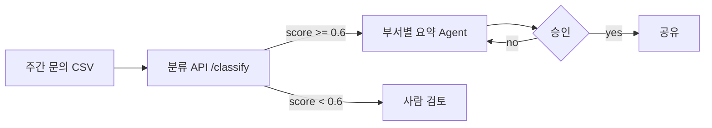

# edu-2026h2-orchestration

2026 하반기 16회차 **Agent Orchestration** (EDU-2026-H2-16, 2026-12-24) 실습 저장소입니다. 환경: Python 3.12, Conda 환경 `hs-2026h2`

> 🚧 준비 중입니다. 내용은 12/19 하반기 프로젝트 발표회 이후 채웁니다.

## 예정 예제

"주간 문의 모음 → 14회차 분류 API → 부서별 요약 Agent → 사람 승인 후 공유"

## 할 일

- [ ] `workflow.py`: LangGraph로 위 흐름 (단계별 실패 처리, 재실행, 비용 상한)
- [ ] `n8n/`: 같은 흐름을 n8n으로 만든 export (비교용)
- [ ] 7회차 `hs-docs` MCP 서버 재사용
- [ ] 연말 참석 인원 확인 후 실습 분량 조정
